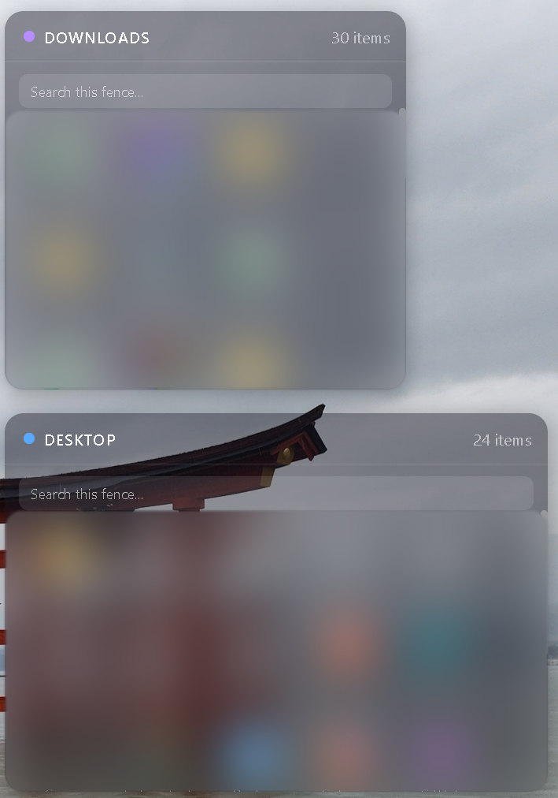
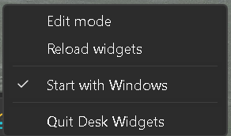

# Desk Widgets

A Windows desktop dashboard built with Tauri. Widgets live on the desktop behind your icons: clock, weather, calendar, music with a spinning record view, notes, countdowns, system stats, and fences that organize desktop files and folders.

**[Download the latest version](https://github.com/gfeuling1/desk-widgets/releases/latest)**


## Features

- **Clock, weather, and calendar.** Weather comes from [Open-Meteo](https://open-meteo.com/en/docs), with the [National Weather Service](https://www.weather.gov/documentation/services-web-api) as a backup for US locations. The calendar reads Google, Outlook, or iCloud iCal links using [ical.js](https://github.com/kewisch/ical.js).
- **Music.** Shows what's playing from any app that reports to Windows media controls (Spotify, YouTube Music in a browser, and others), with album art, play and pause, and skip. You can switch between a record player view and a simple view.
- **Fences.** Group desktop icons into panels. A fence can show a folder (Desktop, Downloads, or any path) or a hand-picked set of items. You can collapse, search, rename, recolor, and drag items between fences, or drop folders in from File Explorer.
- **Notes, countdown, and system stats.** Jot notes right on the desktop, count down to a date, and watch CPU, memory, disk, battery, and network speed.
- **Edit mode.** Press Ctrl+Alt+W from anywhere to drag, resize, add, or remove widgets. The layout saves automatically.
- **Lives on the desktop.** Pinned behind your icons. Clicks pass through to the desktop except on widgets, and it reattaches itself if Explorer restarts.
- **Settings panel.** Search for your weather location, pick units, and add calendar links. Everything is saved on your computer, never in the code or the installer.
- **Tray menu.** Edit mode, settings, reload, Start with Windows, and quit.

| Edit mode | Music | Fences |
|---|---|---|
|  |  |  |



## Tech stack

- [Tauri v2](https://v2.tauri.app/) with a Rust backend
- Vanilla JavaScript, HTML, and CSS, with no framework or bundler
- Windows APIs through the [windows crate](https://github.com/microsoft/windows-rs): media session, shell icons, and window pinning
- [sysinfo](https://github.com/GuillaumeGomez/sysinfo) for system stats
- Tauri plugins: [store](https://v2.tauri.app/plugin/store/), [http](https://v2.tauri.app/plugin/http-client/), [autostart](https://v2.tauri.app/plugin/autostart/), [single-instance](https://v2.tauri.app/plugin/single-instance/), and [global-shortcut](https://v2.tauri.app/plugin/global-shortcut/)
- GitHub Actions with [tauri-action](https://github.com/tauri-apps/tauri-action) to build the installer for each release

## Install

Download the file ending in `x64-setup.exe` from the [latest release](https://github.com/gfeuling1/desk-widgets/releases/latest) and run it. Windows may show a SmartScreen warning because the app isn't code-signed: click **More info**, then **Run anyway**. Desk Widgets starts with Windows from then on.

## Run it from source

You need Windows 10 or 11 and the [Tauri prerequisites](https://v2.tauri.app/start/prerequisites/): Rust, Node.js, Microsoft C++ Build Tools, and the WebView2 runtime.

```powershell
git clone https://github.com/gfeuling1/desk-widgets.git
cd desk-widgets
npm install
npm run tauri dev
```

Then click the Desk Widgets icon in the tray (the ^ arrow at the right end of the taskbar) and choose **Settings...** to set your location, units, and calendars. For a Google Calendar, open Google Calendar's Settings, choose the calendar under "Settings for my calendars", and copy "Secret address in iCal format". Outlook and iCloud calendar links work too.

Settings are saved in `%APPDATA%\com.gideonfeuling.deskwidgets\layout.json`, along with your widget layout.

Only one copy runs at a time. If the installed version is running, close it before starting the dev build.

To build an installer:

```powershell
npm run tauri build
```

The installer is created in `src-tauri\target\release\bundle\nsis\`.

To publish a release, bump the version in `package.json`, `src-tauri/tauri.conf.json`, and `src-tauri/Cargo.toml`, push, then run the **Release** workflow from the Actions tab. It builds the installer on GitHub and attaches it to a draft release.

## Project structure

```
src/                   Front end
  main.js              Widgets, layout, drag and resize, edit mode
  fences.js            Fence widget
  settings.js          Settings panel and saved settings
  weather.js           Open-Meteo with a National Weather Service backup
  widgets-extra.js     Notes, countdown, and system stats widgets
  calendar.js          iCal parsing
  vendor/ical.js       iCal parser
src-tauri/src/         Rust backend
  lib.rs               App setup, plugins, and commands
  desktop.rs           Desktop pinning, click-through, Explorer watchdog
  media.rs             Windows media session (now playing, artwork, controls)
  fences.rs            Folder listing, file icons, opening files
  tray.rs              Tray icon and menu
  shortcut.rs          Ctrl+Alt+W global shortcut
  stats.rs             CPU, memory, disk, network, and battery
```

## Known issues

- Some networks can't reach `api.open-meteo.com` because of a DNS issue ([Open-Meteo #2329](https://github.com/open-meteo/open-meteo/issues/2329)). US locations fall back to the National Weather Service automatically.
- The installer isn't code-signed, so Windows SmartScreen warns the first time you run it.
