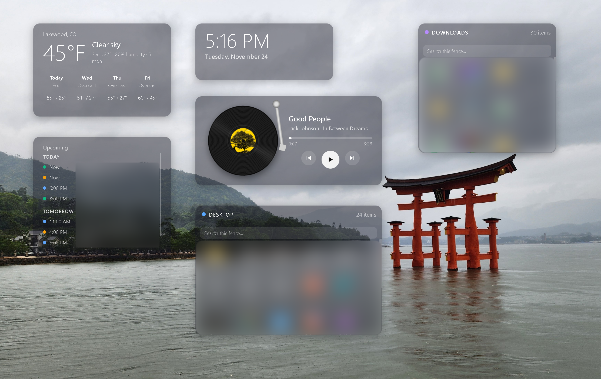
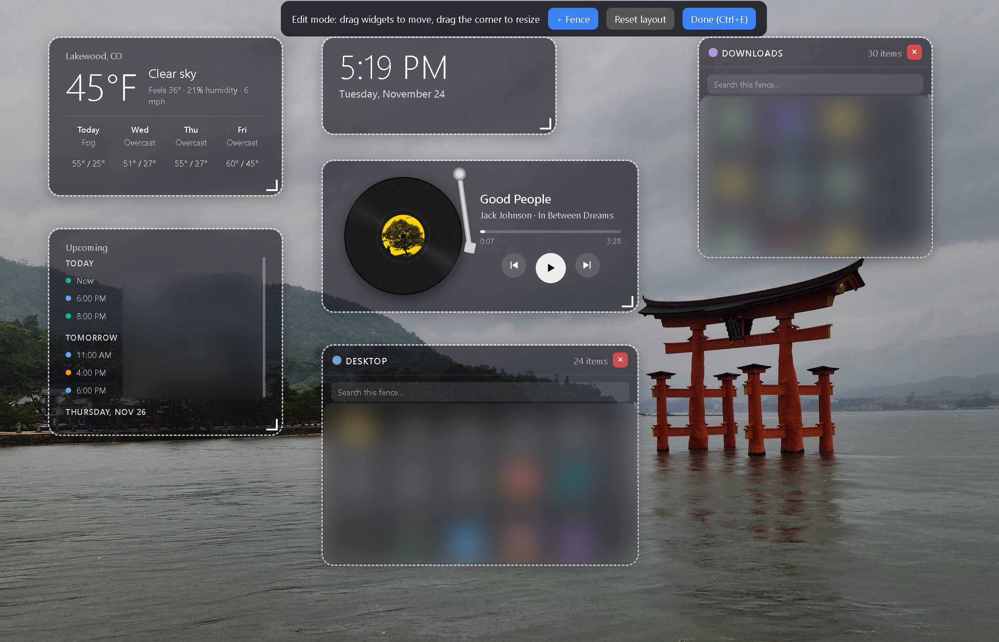
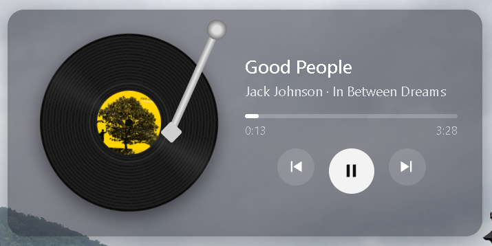

# Desk Widgets

A Windows desktop dashboard built with Tauri. Widgets live on the desktop behind your icons: clock, weather, calendar, music with a spinning record view, and fences that organize desktop files and folders.



## Features

- **Clock, weather, and calendar.** Weather comes from [Open-Meteo](https://open-meteo.com/en/docs). The calendar reads Google Calendar iCal links using [ical.js](https://github.com/kewisch/ical.js).
- **Music.** Shows what's playing from any app that reports to Windows media controls (Spotify, YouTube Music in a browser, and others), with album art, play and pause, and skip. You can switch between a record player view and a simple view.
- **Fences.** Group desktop icons into panels. A fence can show a folder (Desktop, Downloads, or any path) or a hand-picked set of items. You can collapse, search, rename, recolor, and drag items between fences, or drop folders in from File Explorer.
- **Edit mode.** Drag and resize any widget. The layout saves automatically.
- **Lives on the desktop.** Pinned behind your icons. Clicks pass through to the desktop except on widgets, and it reattaches itself if Explorer restarts.
- **Tray menu.** Edit mode, reload, Start with Windows, and quit.

| Edit mode | Music | Fences |
|---|---|---|
|  |  |  |


## Tech stack

- [Tauri v2](https://v2.tauri.app/) with a Rust backend
- Vanilla JavaScript, HTML, and CSS, with no framework or bundler
- Windows APIs through the [windows crate](https://github.com/microsoft/windows-rs): media session, shell icons, and window pinning
- Tauri plugins: [store](https://v2.tauri.app/plugin/store/), [http](https://v2.tauri.app/plugin/http-client/), [autostart](https://v2.tauri.app/plugin/autostart/), and [single-instance](https://v2.tauri.app/plugin/single-instance/)

## Run it locally

You need Windows 10 or 11 and the [Tauri prerequisites](https://v2.tauri.app/start/prerequisites/): Rust, Node.js, Microsoft C++ Build Tools, and the WebView2 runtime.

```powershell
git clone https://github.com/gfeuling1/desk-widgets.git
cd desk-widgets
npm install
Copy-Item src\config.example.js src\config.local.js
```

Open `src\config.local.js` and replace the placeholder with your Google Calendar secret iCal link. In Google Calendar, go to Settings, choose a calendar under "Settings for my calendars", and copy "Secret address in iCal format". You can add more calendars to the list, each with its own name and color.

To change the weather location or units, edit `SETTINGS.weather` near the top of `src\main.js`.

```powershell
npm run tauri dev
```

Only one copy runs at a time. If the installed version is running, close it before starting the dev build.

To build an installer:

```powershell
npm run tauri build
```

The installer is created in `src-tauri\target\release\bundle\nsis\`.

## Project structure

```
src/                   Front end
  main.js              Widgets, layout, drag and resize, edit mode
  fences.js            Fence widget
  calendar.js          Calendar loading and iCal parsing
  config.example.js    Template for your private calendar links
  vendor/ical.js       iCal parser
src-tauri/src/         Rust backend
  lib.rs               App setup, plugins, and commands
  desktop.rs           Desktop pinning, click-through, Explorer watchdog
  media.rs             Windows media session (now playing, artwork, controls)
  fences.rs            Folder listing, file icons, opening files
  tray.rs              Tray icon and menu
```

## Known issues

- Some networks can't reach `api.open-meteo.com` because of a DNS issue ([Open-Meteo #2329](https://github.com/open-meteo/open-meteo/issues/2329)).
- Calendar links from `config.local.js` are bundled into the installer at build time, so don't share installers you've built yourself. A settings panel to fix this is planned.

## Roadmap

- Settings panel for calendar links, location, and units
- Backup weather source
- Global keyboard shortcut
- System stats, notes, and countdown widgets
- Layout profiles
